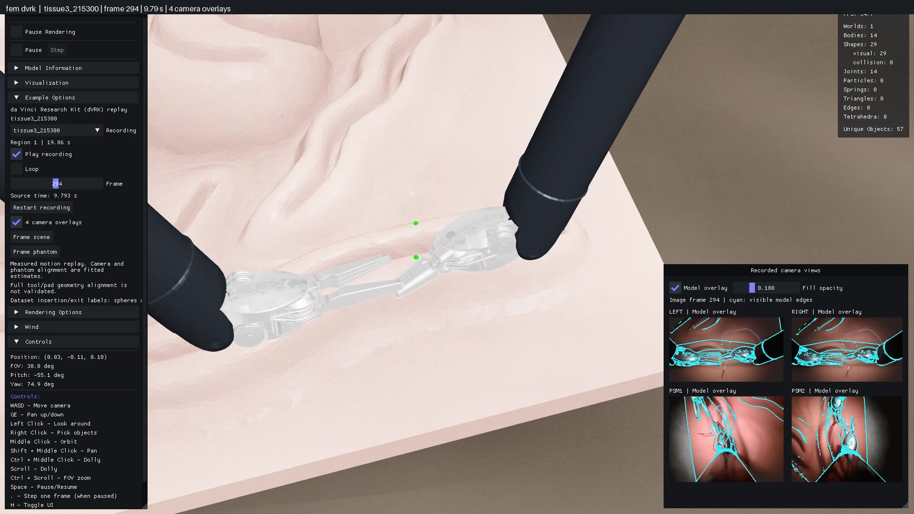
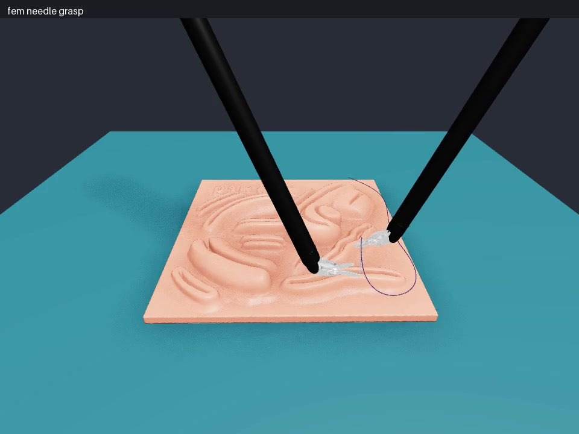
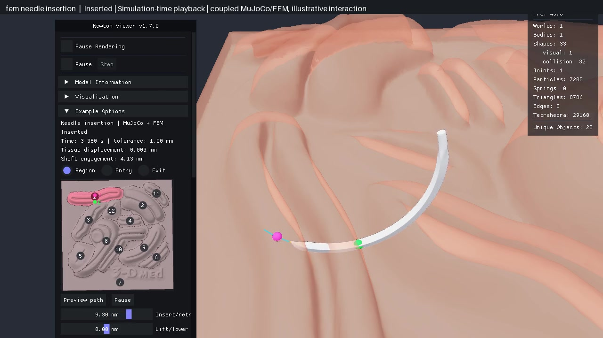
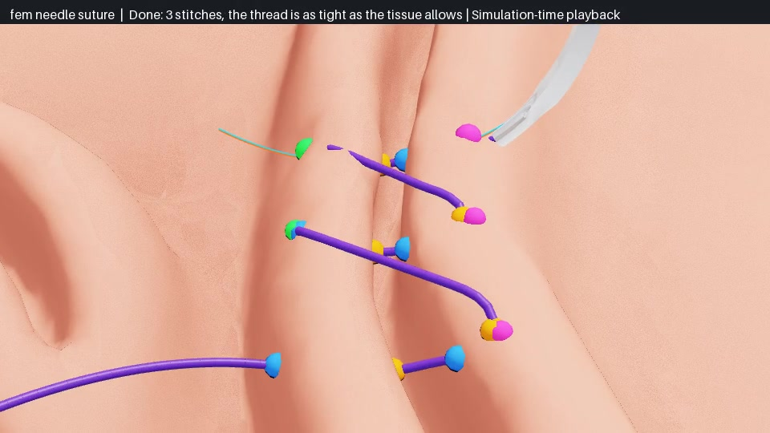
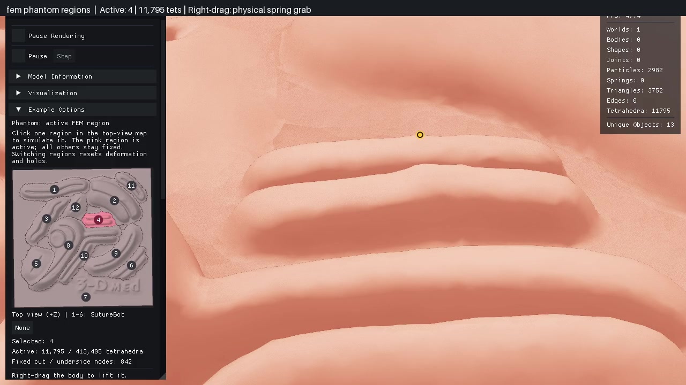
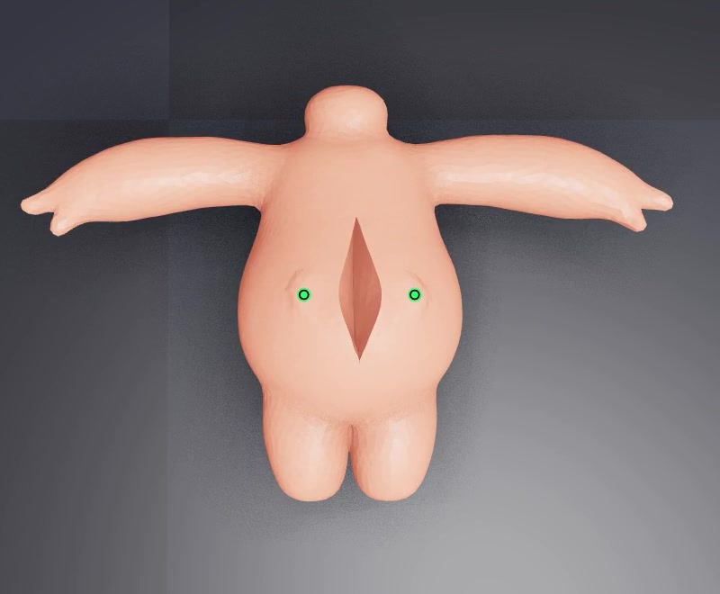
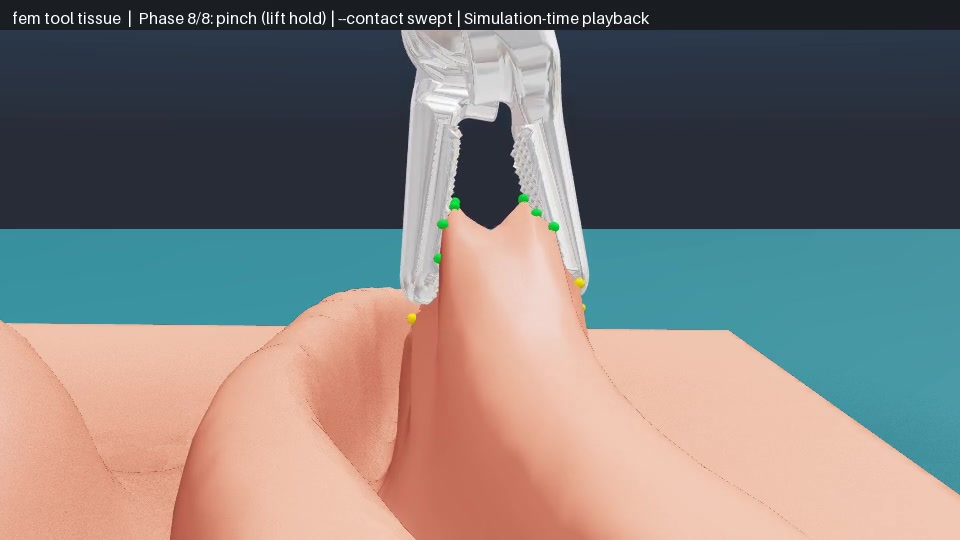
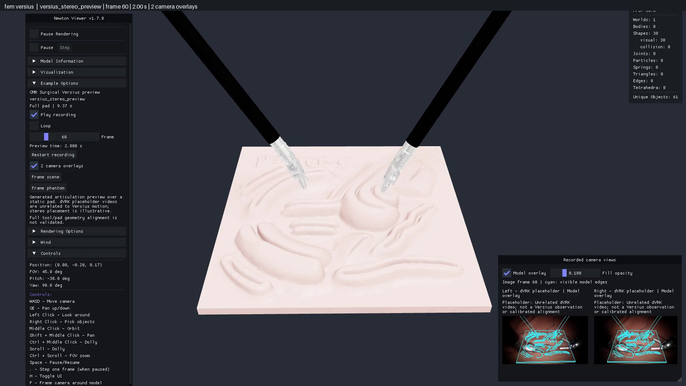
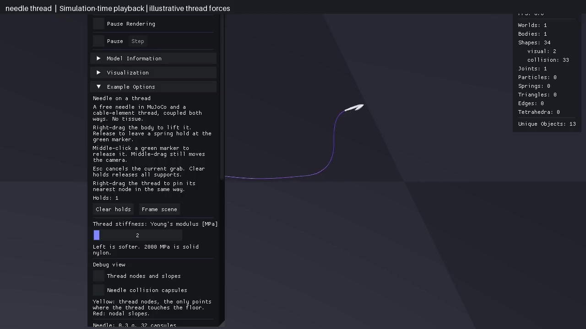

<!-- Generated by tools/build_readme.py; edit project metadata, example docstrings or the generator. -->
# newton-solver-suturebot

Self-contained SutureBot replay, tissue FEM cutting and physical MuJoCo needle insertion.

FEM, cutting, needle coupling and prepared assets are included in this repository.
No sibling solver checkout or source dataset is required to run the bundled examples.

## Quickstart

From this directory:

```bash
./docker/build.sh
./docker/run.sh --list
./docker/run.sh                 # Choose an example interactively.
./docker/run.sh fem_surgical_incision # Cut the Baymax body; spring grips.
./docker/run.sh fem_needle_grasp # Articulated tools, physical grasp and procedural insertion.
```

Or use Python 3.12 locally:

```bash
uv sync --locked --extra examples
uv run --locked python -m newton_solver_suturebot.examples
```

Run a specific example by appending its name; append `--help` for its options.
See [setup and controls](docs/usage.md) for complete instructions.

## Requirements

- Linux x86-64 or ARM64; Python 3.12 and the locked dependencies.
- CUDA: an NVIDIA driver compatible with the locked CUDA 13 Warp wheel; Docker also needs NVIDIA Container Toolkit.
- Interactive viewing: X11 and a readable `XAUTHORITY` file.
- CPU/headless runs: `./docker/run.sh --cpu --headless <example>`; full-pad scenes can be slow.

## Examples

Examples are discovered from their modules. Click a preview to open the recorded MP4.

| Example | Example |
| --- | --- |
| **[fem_dvrk](src/newton_solver_suturebot/examples/recording/example_fem_dvrk.py)**<br>Replay da Vinci Research Kit (dVRK) recordings with four source-video camera overlays.<br><a href="docs/media/fem_dvrk.mp4"></a><br>`./docker/run.sh fem_dvrk` | **[fem_needle_grasp](src/newton_solver_suturebot/examples/grasp/example_fem_needle_grasp.py)**<br>Insert a physically grasped needle with articulated dVRK tools, FEM tissue and thread.<br><a href="docs/media/fem_needle_grasp.mp4"></a><br>`./docker/run.sh fem_needle_grasp` |
| **[fem_needle_insertion](src/newton_solver_suturebot/examples/needle/example_fem_needle_insertion.py)**<br>Select entry and exit material points, then drive one MuJoCo needle into FEM tissue.<br><a href="docs/media/fem_needle_insertion.mp4"></a><br>`./docker/run.sh fem_needle_insertion` | **[fem_needle_suture](src/newton_solver_suturebot/examples/needle/example_fem_needle_suture.py)**<br>Suture a wound: the needle makes a row of stitches through FEM tissue, its thread follows and closes the wound.<br><a href="docs/media/fem_needle_suture.mp4"></a><br>`./docker/run.sh fem_needle_suture` |
| **[fem_phantom_regions](src/newton_solver_suturebot/examples/phantom/example_fem_phantom_regions.py)**<br>Select one SutureBot wound on a clickable map and right-drag the suture pad.<br><a href="docs/media/fem_phantom_regions.mp4"></a><br>`./docker/run.sh fem_phantom_regions` | **[fem_surgical_incision](src/newton_solver_suturebot/examples/incision/example_fem_surgical_incision.py)**<br>Cut the Baymax body, 135 mm across and on its back: slice, drill, carve; right-drag to lift cut material.<br><a href="docs/media/fem_surgical_incision.mp4"></a><br>`./docker/run.sh fem_surgical_incision` |
| **[fem_tool_tissue](src/newton_solver_suturebot/examples/grasp/example_fem_tool_tissue.py)**<br>Press and slide the jaws of an articulated dVRK tool on FEM tissue, then pinch a ridge of it and lift it, in eight phases: the rig of the tool/tissue contact.<br><a href="docs/media/fem_tool_tissue.mp4"></a><br>`./docker/run.sh fem_tool_tissue` | **[fem_versius](src/newton_solver_suturebot/examples/recording/example_fem_versius.py)**<br>Preview CMR Surgical Versius instruments over the full pad with placeholder stereo video.<br><a href="docs/media/fem_versius.mp4"></a><br>`./docker/run.sh fem_versius` |
| **[needle_thread](src/newton_solver_suturebot/examples/needle/example_needle_thread.py)**<br>Lift a suture needle on its thread with the mouse: a free MuJoCo needle pulls a cable-element thread.<br><a href="docs/media/needle_thread.mp4"></a><br>`./docker/run.sh needle_thread` |  |

The pad, incision and needle examples advance physical simulation. `fem_needle_grasp` uses
procedural joint control with a physical jaw grasp; no Isaac Lab or trained policy is required.
By default its tools push the tissue where they touch it (swept tool/tissue contact) and its
window plans for a picture no later than 66.7 ms after the one before (frame time budget);
`--no-tool-tissue-contact` and `--frame-budget 0` switch them off
([usage](docs/usage.md#standalone-articulated-needle-grasp)).
`fem_dvrk` replays measured
da Vinci Research Kit motion; `fem_versius` previews generated motion with labeled dVRK
placeholder videos. Both viewing scenes have static tissue. Movie playback rate is not live FPS;
loaded needle handling has not demonstrated sustained 60 FPS.

## Documentation

| Guide | Contents |
| --- | --- |
| [Usage](docs/usage.md) | Setup, controls and example workflows |
| [Versius preview](docs/versius-recording.md) | Generated instrument motion and placeholder-video scope |
| [Repository layout](docs/layout.md) | Local solvers, examples and bundled assets |
| [Method](docs/method.md) | Implemented equations, numerical assumptions and gradient limits |
| [Papers](docs/papers.md) | Primary sources and implementation mappings |
| [Validation](docs/validation.md) | Tests, physical checks, failed comparisons and performance scope |
| [Provenance](docs/provenance.md) | Asset attribution and historical versus current evidence |
| [Development](docs/development.md) | Documentation generation, recording and contributor commands |

## Profiling

```bash
./docker/run.sh --nsys --list
./docker/run.sh --nsys <example>
```

See [profiling instructions](nsys/README.md) for capture scope and interpretation.
Profiler overhead and simulation-time playback must not be reported as live throughput.

## Check and build

```bash
uv run --locked ruff check .
uv run --locked ruff format --check .
uv run --locked python -m unittest discover -s tests -v
NEWTON_TEST_DEVICE=cuda:0 uv run --locked python -m unittest discover -s tests -v
python3 tools/build_readme.py --check --require-videos
uv build
```

Full physical tests can take several minutes. See [validation](docs/validation.md)
for measured results and the scope of each check.

License: [Apache-2.0](LICENSE). Required asset and code attribution: [THIRD_PARTY_NOTICES](THIRD_PARTY_NOTICES).
